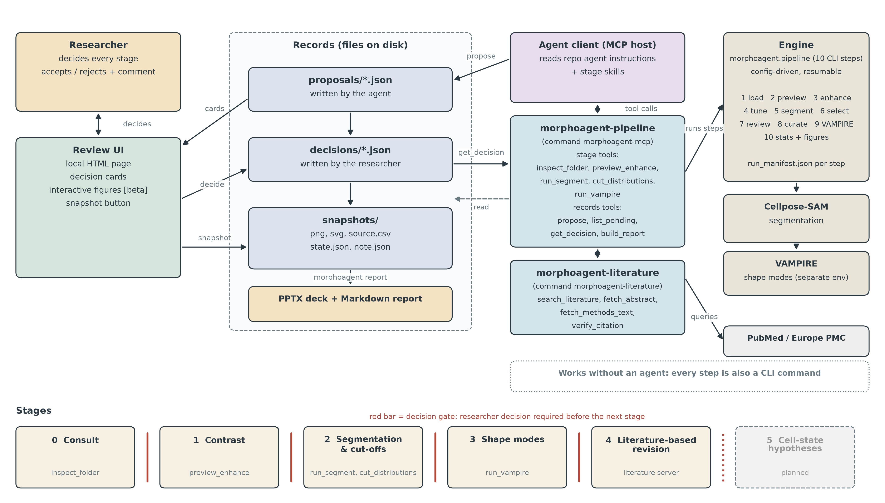

# morphoAgent

[](https://github.com/myLabTechnician/morphoAgent/actions/workflows/ci.yml)
[](LICENSE)
[](pyproject.toml)

**An agentic workflow for cell morphology analysis, from image calibration to shape-mode
clustering, with the researcher in the loop.**

*Status: v0.1.0, research software. Interfaces may change between minor versions.*



*Architecture. Vector version: [docs/figures/architecture.svg](docs/figures/architecture.svg); generator:
[docs/figures/make_architecture.py](docs/figures/make_architecture.py).*

**Contents** — [What it does](#what-it-does) · [What the results are and are not](#what-the-results-are-and-are-not) ·
[Installation](#installation) · [Quick start A: with an agent client](#quick-start-a-with-an-agent-client) ·
[Quick start B: without an agent](#quick-start-b-without-an-agent) · [MCP servers and tools](#mcp-servers-and-tools) ·
[Outputs](#outputs) · [Reproducibility](#reproducibility) · [Validation](#validation) · [Documentation](#documentation) · [Roadmap](#roadmap) ·
[Citation](#citation) · [License](#license) · [Agent client](#agent-client)

## What it does

`morphoagent` turns a folder of single-channel bright-field (phase-contrast) microscope images into
per-cell shape measurements, shape modes and object-level statistics. It has two layers:

* **Pipeline** (`morphoagent.pipeline`): a config-driven, resumable ten-step engine with a
  command-line interface. It runs without any agent, and every step leaves a `run_manifest.json`
  describing exactly what it did.
* **Agent tools** (`morphoagent.mcp`): two [Model Context Protocol](https://modelcontextprotocol.io)
  servers that expose the stages as typed tools, so an agent can run a stage, read back the numbers
  and propose the next decision, while the researcher makes every decision.

### Stages

| Stage | What is decided | Tools | Pipeline steps |
|---|---|---|---|
| 0 consultation | image folder, file-name pattern -> conditions, control group, pixel size, replicate unit | `inspect_folder` | 1 |
| 1 contrast | display enhancement preset (display only; never changes measurements) | `preview_enhance` | 2 (3) |
| 2 masks and cut-offs | Cellpose setting, minimum area, frame-contact maximum, optional curation | `run_segment`, `cut_distributions` | 4, 5 (6–8) |
| 3 shape modes | number of VAMPIRE shape modes K | `run_vampire` | 9 (10) |
| 4 literature | whether to revise a choice of stages 1–3 in light of verified literature | `search_literature`, `fetch_abstract`, `fetch_methods_text`, `verify_citation` | — |

### Decision gates, snapshots, reports

* **Proposal** — after each stage the agent writes a proposal card (`propose`): options with
  figures, tables, key numbers, configuration changes, verified references and a recommendation.
* **Decision gate** — the researcher accepts one option or rejects the proposal with a comment on
  the **Decisions** tab of the review page (`morphoagent ui serve`). Stage tools refuse to run while
  a proposal of an earlier stage is undecided.
* **Snapshot** — every decision (and every Snapshot click) writes a folder with the figure as a
  300-dpi PNG and SVG, its source table, the settings and a note. Snapshots are never overwritten.
* **Report** — `morphoagent report` builds a 16:9 slide deck and a Markdown report, one slide per
  snapshot, numbered `<prefix>_report_<YYMMDD>_c<N>` and never overwritten.

Formats and rules: [docs/protocol.md](docs/protocol.md); review page: [docs/ui.md](docs/ui.md).

### The ten pipeline steps

```
images ─► 1 load ─► 2 enhance-preview ─► 3 enhance ─► 4 segment-tune ─► 5 segment
        ─► 6 select ─► 7 review ─► 8 curate (optional) ─► 9 vampire ─► 10 stats
```

| # | Command | What it does | Default parameters |
|---|---|---|---|
| 1 | `load` | List images, parse `condition` / `field` from file names, count images per condition, skip all-zero captures | `name_regex: ^(?P<condition>.+)_(?P<field>Image\d+)$`, skip if max pixel ≤ 0 |
| 2 | `enhance-preview` | Apply every enhancement preset to sample images; contact sheet + metrics (percentiles, edge strength, flat-background noise) | samples = first image of each of the first 4 conditions; presets `figure-default`, `tone-unsharp`, `clahe`, `none` |
| 3 | `enhance` | Apply the chosen preset to all images (display / review only) | `preset: figure-default` (960×720, median → 125, fitted kernel + tone curve) |
| 4 | `segment-tune` | Cellpose-SAM parameter grid on sample images; outline montages with object counts | cellprob {−1, −2, −3, −4} × diameter {auto, 60, 100} × downscale {0.125, 0.25}, flow 0.8 |
| 5 | `segment` | Cellpose-SAM on the **raw** grey image after downscaling; labels upscaled (nearest neighbour) to full size; full-resolution measurements | model `cpsam`, flow_threshold 0.8, cellprob_threshold −1.0, diameter auto, downscale 0.125 |
| 6 | `select` | Largest piece per label → optional image trim → area minimum → frame-contact rule; count tree in the manifest | largest piece on (8-connected), image trim 0.0 (off), `area_min_px` 2000, `frame_contact_px` 24 |
| 7 | `review` | Numbered overlays (kept = red solid, frame contact = pale-red dashed) and a 16:9 PPTX deck, one slide per field | line widths 6 / 3 px, font size ∝ √area (38–78 px) |
| 8 | `curate` | Optional delete / merge edits from a CSV; re-measures edited objects; originals untouched | asks "Is curation needed? [y/N]" unless `--yes` / `--skip`; skips when no CSV |
| 9 | `vampire` | VAMPIRE shape modes on kept cells (all conditions pooled), elbow analysis, modes renumbered by aspect ratio, mode morphometry and mean contours | 50 contour points, K = [4], 20 PCs, k-means++ n_init 3 random_state 9, elbow K = 2…20 |
| 10 | `stats` | Object-level summaries (n, mean, median, ratio, Welch p, BH q), Fisher tests of mode composition, box + jitter plots, mode-fraction bars | reference = first condition; stars from uncorrected p; Shannon diversity off |

Details, rationale and every parameter: [docs/pipeline.md](docs/pipeline.md),
[docs/configuration.md](docs/configuration.md).

## What the results are and are not

* **Are**: per-object measurements (area, aspect ratio, form factor, solidity, eccentricity, extent,
  perimeter; area in µm² when a pixel size is given), data-driven **shape modes** (VAMPIRE clusters of
  cell outlines), their composition per condition, and object-level tests between conditions.
* **Are not**: cell-state or cell-type calls. A shape mode is a cluster of outlines; giving it a
  biological meaning needs independent evidence. Statistics are at the object level (one value per
  cell); replicate structure (images, wells, experiments) is not modelled.

## Installation

Two environments are used: the **main environment** (pipeline, Cellpose-SAM, review page, MCP
servers) and a separate **VAMPIRE environment** (step 9 only).

### Main environment

```bash
git clone https://github.com/myLabTechnician/morphoAgent.git morphoAgent && cd morphoAgent
python -m venv .venv && source .venv/bin/activate      # or conda / mamba, Python >= 3.10
pip install -e ".[segment,mcp,dev]"                    # Cellpose (steps 4-5), MCP servers, pytest + ruff
```

Cellpose-SAM runs on a CUDA GPU when available (`segment.gpu: true`) and falls back to the CPU with
a warning. Install the PyTorch build that matches your GPU first if needed (see the Cellpose
documentation).

### VAMPIRE environment (step 9)

VAMPIRE is **not** bundled. Clone it and create an environment that satisfies its requirements
(Python 3.8 has been tested; it needs numpy, pandas, scipy, scikit-learn, OpenCV, matplotlib,
Pillow, scikit-image and tkinter):

```bash
git clone https://github.com/kukionfr/VAMPIRE_open.git
git -C VAMPIRE_open checkout cd8ac36ce60c9773be2bfda48c1c375372f1312c   # tested commit
```

Then point the configuration at it:

```yaml
vampire:
  src_path: /path/to/VAMPIRE_open/Source Code
  python: /path/to/vampire-env/bin/python
```

`morphoagent` runs `src/morphoagent/pipeline/vampire_runner.py` with that interpreter (environment
variable `PYTHONNOUSERSITE=1` is set). The runner imports only the standard library, numpy, pandas
and Pillow at module level and is Python 3.8-compatible, so `morphoagent` does not have to be
installed in the VAMPIRE environment.

## Quick start A: with an agent client

1. Install the main environment (above) and activate it, so that `morphoagent-mcp` and
   `morphoagent-literature` are on the `PATH` of the client.
2. Open the repository folder in an MCP-capable agent client. `.mcp.json` registers the two
   servers; approve them when the client asks.
3. Ask, for example: *"Set up a morphology analysis of the images in /path/to/images; CTRL is the
   control."* The agent works stage by stage (agent instructions and stage skills are in the
   repository, see [Agent client](#agent-client)).
4. Start the review page and decide each proposal there:

   ```bash
   morphoagent ui serve -c my_config.yaml        # open http://127.0.0.1:8765/ -> tab "5. Decisions"
   ```

5. When the stages are decided: *"Build the report."* (`build_report`, or
   `morphoagent report -c my_config.yaml --out reports/`).

The agent never decides: it reads decisions back with `get_decision`. Tools and rules:
[docs/mcp.md](docs/mcp.md), [docs/literature.md](docs/literature.md).

## Quick start B: without an agent

```bash
morphoagent init-config my_config.yaml        # full default config to edit (or start from configs/example.yaml)
```

Minimal config:

```yaml
output_dir: /path/to/output
input:
  image_dir: /path/to/images
  strip_prefix: "exp01_20X_"         # removed before parsing
  strip_suffix: "_ch00"
conditions: {order: [CTRL, DRUG_A], reference: CTRL}
vampire: {src_path: /path/to/VAMPIRE_open/Source Code, python: /path/to/vampire-env/bin/python}
stats:
  pixel_calibration: {field_width_um: 1000.0, image_width_px: 2048, binning: 2}   # or a number: pixel_size_um: 0.25
```

```bash
morphoagent run -c my_config.yaml --from 1 --to 4    # inventory, enhancement and segmentation previews
#   look at 02_enhance-preview/contact_sheet.png and 04_segment-tune/montages/, adjust the config
morphoagent run -c my_config.yaml --from 3 --to 7 --overwrite   # (3 again only if you changed the preset)
#   open 07_review/review_deck.pptx (or: morphoagent ui serve), write curation_edits.csv, set curate.edits_csv
morphoagent run -c my_config.yaml --from 8 --to 10 --yes
```

Every step is also a subcommand: `morphoagent load -c cfg.yaml`, `morphoagent segment -c cfg.yaml`, ….

* **Step 2** writes `contact_sheet.png` (rows = sample images, columns = presets) and
  `preview_metrics.csv` (`edge_strength` higher = crisper; `flat_noise` lower = cleaner background).
  Enhancement affects only the images used for display and review.
* **Step 4** writes one montage per sample image (one panel per setting with the object count and the
  count above `area_min_px`) and `tune_counts.csv`; the current setting is marked `DEFAULT`.
* **Resuming**: each step reads only the files of earlier steps, so any range can be (re-)run with
  `run --from N --to M`. A step refuses to write into a non-empty step folder unless `--overwrite` is
  given; downstream steps are not invalidated automatically.
* **Curation**: list edits in a CSV (template `07_review/curation_template.csv`) or click the masks
  on the review page and download the CSV from its Export tab:

  ```csv
  operation,image,labels,target
  delete,CTRL_Image004,19;21,
  merge,DRUG_A_Image010,17;18,17
  ```

## MCP servers and tools

| Server (command) | Tools |
|---|---|
| `morphoagent-pipeline` (`morphoagent-mcp`) | `inspect_folder`, `preview_enhance`, `run_segment`, `cut_distributions`, `run_vampire`, `propose`, `list_pending`, `get_decision`, `build_report` |
| `morphoagent-literature` (`morphoagent-literature`) | `search_literature`, `fetch_abstract`, `fetch_methods_text`, `verify_citation` |

Both use the stdio transport and are registered in `.mcp.json`. The tools are thin wrappers of plain
Python functions, which can also be called directly. The literature server queries PubMed and
Europe PMC; `verify_citation` flags a PMID that does not exist and a PMID and DOI that belong to
different papers. It sends no e-mail address or API key unless configured. Arguments, outputs and
rules: [docs/mcp.md](docs/mcp.md), [docs/literature.md](docs/literature.md).

Command-line steps that have no tool (select, review, curate, stats) run with
`morphoagent <step> -c <config>`.

## Outputs

```
output_dir/
  01_load/            inventory.csv, images_per_condition.csv, skipped_all_zero.csv
  02_enhance-preview/ contact_sheet.png, preview_metrics.csv, images/
  03_enhance/         images/<condition>_<field>_enhanced.png, enhance_log.csv
  04_segment-tune/    settings.csv, tune_counts.csv, montages/
  05_segment/         labels/<image>_labels.tif, objects.csv, images.csv
  06_select/          labels/, objects.csv, cells.csv, fields.csv
  07_review/          review_deck.pptx, overlays/, curation_template.csv
  08_curate/          labels/, objects.csv, cells.csv, fields.csv, applied_edits.csv
  09_vampire/         shape_modes_K*.csv, mode_mapping_K*.csv, mode_morphometry_K*.csv, elbow_*, figures/, vampire_work/
  10_stats/           object_metrics.csv, summary_by_condition.csv, mode_composition_K*.csv, figures/
  ui/                 review.html, review_manifest.json   (morphoagent ui build)
  agent/              cut-distributions_<hash>/ ...       (agent tools that are not pipeline steps)
  agent/records/      proposals/, decisions/, snapshots/  (researcher-in-the-loop records)
```

Every plot is saved as a 300-dpi transparent PNG, an SVG and `source_<name>.csv` holding exactly the
plotted coordinates. Table columns and figure formats: [docs/outputs.md](docs/outputs.md).

## Reproducibility

* **Manifests** — every step folder and agent-tool folder has a `run_manifest.json`: parameters,
  package versions, counts in and out, UTC timestamp and the hash of the configuration file.
  Step 10 records the pixel size actually used (`pixel_size_um_effective`).
* **Field tables** — `select.field_table` fixes the exact set of fields (and, optionally, curated
  label files and the measurement grid per field), so a completed analysis can be re-run on the
  same objects ([docs/pipeline.md](docs/pipeline.md#field-table)).
* **Decision records** — proposals and decisions are versioned JSON files (`morphoagent-proposal/1`,
  `morphoagent-decision/1`, schemas in [docs/schemas](docs/schemas)); a decision stores the hash of
  the proposal it answers. Records and snapshots are never overwritten.
* **No silent overwrite** — results are replaced only with `--overwrite` (or `overwrite: true`),
  and only that step's folder.
* **Exact constants** — the pixel size can be derived from the field width
  (`stats.pixel_calibration`) instead of a rounded number ([docs/configuration.md](docs/configuration.md#stats-step-10)).

## Validation

On a 14-condition phase-contrast dataset (126 images), the pipeline reproduced a previously
completed manual analysis exactly: identical segmentation, the same 2,561 selected cells, identical
shape-mode assignments and statistics.

The test suite (`pytest`) uses synthetic images only; Cellpose is replaced by a threshold stand-in,
so it runs without a GPU or model download.

## Documentation

| Document | Contents |
|---|---|
| [docs/pipeline.md](docs/pipeline.md) | The ten steps: what each does, rationale, outputs |
| [docs/configuration.md](docs/configuration.md) | Every configuration key and its default |
| [docs/outputs.md](docs/outputs.md) | Table columns and figure formats |
| [docs/mcp.md](docs/mcp.md) | MCP pipeline server: tools, arguments, rules |
| [docs/literature.md](docs/literature.md) | MCP literature server: search, abstracts, methods text, citation checks |
| [docs/protocol.md](docs/protocol.md) | Proposals, decisions, snapshots and reports |
| [docs/ui.md](docs/ui.md) | Browser review page |
| [CONTRIBUTING.md](CONTRIBUTING.md) | Coding standards, tests, adding presets and tools |
| [CHANGELOG.md](CHANGELOG.md) | Release notes |

## Roadmap

* Interactive figures on the review page (beta).
* Stage 5: cell-state hypotheses from shape modes, with the evidence they need (not available yet).
* More display modules for the review page and the reports.
* Additional imaging modalities (beyond single-channel bright-field / phase contrast).

## Citation

If you use morphoAgent, please cite it using the metadata in [CITATION.cff](CITATION.cff)
(GitHub shows it as "Cite this repository"). Please also cite the tools the pipeline runs:

* **Cellpose-SAM** — Pachitariu M, Rariden M, Stringer C. Cellpose-SAM: superhuman generalization
  for cellular segmentation. *bioRxiv* (2025). [doi:10.1101/2025.04.28.651001](https://doi.org/10.1101/2025.04.28.651001)
* **VAMPIRE** — Phillip JM, Han K-S, Chen W-C, Wirtz D, Wu P-H. A robust unsupervised machine-learning
  method to quantify the morphological heterogeneity of cells and nuclei. *Nat Protoc* 16, 754–774
  (2021). [doi:10.1038/s41596-020-00432-x](https://doi.org/10.1038/s41596-020-00432-x) ·
  code: <https://github.com/kukionfr/VAMPIRE_open>
* scikit-image, SciPy and pandas, as appropriate.

## License

morphoAgent is free software, distributed under the [GNU General Public License v3.0 only](LICENSE)
(SPDX: `GPL-3.0-only`).

Step 9 runs [VAMPIRE_open](https://github.com/kukionfr/VAMPIRE_open), which is also distributed under
the GNU General Public License v3.0. VAMPIRE is not included in this repository;
`src/morphoagent/pipeline/vampire_runner.py` imports it at run time from a separate checkout given in
the configuration.

## Troubleshooting

| Symptom | Cause / fix |
|---|---|
| `file name(s) do not match input.name_regex` | Check `strip_prefix` / `strip_suffix`; the regex is applied to the stem after stripping and needs groups `condition` and `field` |
| `... already contains results` | Add `--overwrite` (only that step folder is replaced) |
| `step N ... has not been run yet` | Run the earlier step first (`run --from N`) |
| `GPU requested but CUDA is not available` | Cellpose runs on the CPU; install a CUDA-enabled PyTorch to use the GPU |
| `font 'Arial' is not available` | Add the `.ttf` file to `plot.font_paths`, or set `plot.font_family` |
| VAMPIRE step fails | Read `09_vampire/vampire_work/runner.log`; check `vampire.python` can import scikit-learn, cv2 and tkinter |
| `every image has < 2 kept objects` (step 9) | VAMPIRE reads a set as an unlabelled mask when its first image contains one object; such a condition cannot be run |
| Curation `merged object ... has N separate pieces` | Only touching objects can be merged |
| `ui serve`: `refusing to listen on ...` | A non-loopback host needs a token in `$MORPHOAGENT_UI_TOKEN` (or use 127.0.0.1 and an SSH tunnel); see [docs/ui.md](docs/ui.md) |
| `ui serve`: `Address already in use` | Another program uses `ui.port`; pass `--port` |
| A stage tool refuses to run | A proposal of an earlier stage is still pending; decide it on the Decisions tab |

## Agent client

The agent layer (`CLAUDE.md`, `.claude/skills/`, `.mcp.json`) was developed for and tested with Claude Code; the MCP servers work with any MCP-capable client.
